# Silsila architecture

The architecture of Silsila as it exists on 2026-11-02 (`main` at WI-144, release 3.0.0 plus the Unreleased items WI-120 to WI-145). Every statement here is drawn from the repository; where something is configured outside it (hosting dashboards, schedulers), that is said. The diagrams are generated from the editable sources in [`diagrams/`](diagrams/) and are repeated in this file so it reads on GitHub; the PDF is built from this file by `node scripts/architecture-pdf.mjs`.

## 1. Overview

### Product purpose

Silsila is a private, single-owner execution system for a person preparing for software engineering interviews. It answers one question every day: what did I plan, and what actually happened? Weekly routines become dated plans; sessions record real time; DSA practice runs on a revision ladder; job applications carry their interview rounds; each week closes with a review. Rumi, an assistant inside the app, reads the owner's records, makes small changes with Undo and proposes bigger ones as cards.

Live at <https://usesilsila.me> since 2026-10-20. One owner, by design: the sign-in refuses a second account and a database that already belongs to someone else.

### Architecture classification

**A modular monolith with a layered core**, deployed as one Next.js container over one PostgreSQL database (ADR-001).

- _Monolith_: one deployable, one database, one transaction boundary. There are no services, queues or workers; scheduled work is two HTTP endpoints called by external schedulers.
- _Modular_: 31 feature folders under `src/features/`, each with pure rules (`domain.ts`), owner-scoped reads and locked writes (`service.ts`), Server Actions (`actions.ts`), loaders (`page-data.ts`) and its components.
- _Layered_: pages and route handlers call feature services; features call a small **kernel** (`src/lib`, `src/server/lock.ts`, `src/server/action.ts`) that never imports a feature. A test (`tests/boundaries.test.ts`) enforces the kernel rule, that pages never query the database, that Zod stays off client components outside a fixed list, that feature dependencies only shrink, and that every exported Server Action hands its errors to the shared runner.

It is not a strict hexagonal or clean architecture: services call Prisma directly, and 13 pairs of features still import each other (listed in the boundaries test; the list may only shrink).

### Technology stack

| Layer        | Choice                                                                                                                   |
| ------------ | ------------------------------------------------------------------------------------------------------------------------ |
| Runtime      | Node.js 24 in a Docker image (`node:24-bookworm-slim`), `next start`                                                     |
| Framework    | Next.js 16.4.3 App Router, React 19, Server Components by default, Server Actions for forms, webpack build               |
| Language     | TypeScript, strict; Zod 4 for every input                                                                                |
| Data         | PostgreSQL 17 through Prisma 7 and `@prisma/adapter-pg`; 43 models, 29 enums, 35 versioned SQL migrations                |
| Styling      | Tailwind 4 on Silsila's tokens for new UI, hand-written `app.css` in the components layer, three CSS Modules             |
| Time         | date-fns and date-fns-tz; owner's IANA zone (America/Toronto)                                                            |
| Tests        | Vitest (161 files, about 900 tests, database suites on a disposable PostgreSQL), Playwright with axe (21 journeys)       |
| Hosting      | Render (app), Supabase (database), cron-job.org and GitHub Actions (schedulers), Better Stack (monitor)                  |
| Integrations | Google OIDC, Google Calendar API, OpenRouter (Claude Haiku 5.5 on Vertex, zero data retention), Web Push, browser speech |

### Design principles visible in the code

1. **Planned and actual are different records.** `RoutineBlock` → `DailyPlan` → `TimeBlock` → `ActualSession`; nothing derives one from another (ADR-002).
2. **The owner comes from the server session only.** `owner()` in `src/server/db.ts` resolves the cookie; no id from the browser is ever trusted.
3. **Writes are serialised per owner.** Multi-row changes run in a transaction that first locks the owner's `User` row (`locked()` in `src/server/lock.ts`), and idempotency comes from unique keys.
4. **Calendar days are labels, instants are UTC.** SQL `DATE` for days, `timestamptz` for moments, every session pinned to `TimeZone=UTC` (ADR-003, ADR-009).
5. **History is append-only.** Attempts, activities, job activities and stage history are never edited.
6. **Undo over confirmation.** Server Actions return an Undo payload that `src/features/undo/service.ts` replays, checked against its own schema and the owner.
7. **AI reads through the same services and never sees private fields.** Rumi's tools are owner-scoped reads; notes, reflections, compensation and contacts are never read (ADR-024).

### Evolution

| Period                   | Work items                    | What changed in the architecture                                                                                                                                         |
| ------------------------ | ----------------------------- | ------------------------------------------------------------------------------------------------------------------------------------------------------------------------ |
| 2026-09-23 to 2026-10-20 | WI-001 to WI-026 (1.0.0)      | Monolith on PostgreSQL, planned vs actual, UTC sessions and the legacy repair, Google Calendar sync, sign-in and Web Push, Heroku then Render + Supabase, live           |
| 2026-10-25 to 2026-10-31 | WI-027 to WI-098 (2.0.0)      | Today as an agenda, Focus, Close the Day, the roadmap and curriculum, the revision ladder, the AI engine with a pinned provider, Rumi 1                                  |
| 2026-10-31 to 2026-11-01 | WI-099 to WI-119 (3.0.0)      | Rumi 2 and 3: memory, lines, small writes with Undo, cards, voice, streaming answers                                                                                     |
| 2026-11-02               | WI-120 to WI-145 (Unreleased) | The audit's clean-up: one action runner, the kernel and boundaries, page loaders, service splits, retention, ops safety, Tailwind for new UI, Talk with Rumi, this audit |

### Current limitations

- One owner by design; scaling to many users would need tenancy, a shared rate limiter and a job runner.
- Free hosting tiers: a sleeping instance, 0.1 CPU, a 500 MB database, app (Ohio) and database (Canada Central) in different regions, so every statement is a cross-region round trip.
- Rate limits and the snapshot cache live in process memory; a second instance would not share them.
- Voice recognition is the browser's own (Google or Apple), outside the zero-retention AI path, behind consent.

## 2. C4 model

### System context

<!-- diagram: c4-context -->

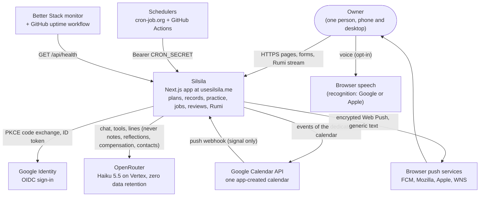

<!-- /diagram -->

The owner is the only person. Google provides identity and the one calendar Silsila creates; OpenRouter provides the language model; browsers' push services deliver notifications; two schedulers call the cron endpoints; monitors read the health endpoint.

### Containers

<!-- diagram: c4-container -->

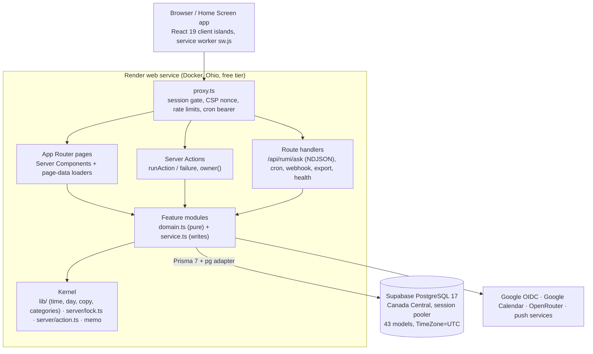

<!-- /diagram -->

There is one application container and one database. Inside the container, `src/proxy.ts` runs before every request: it resolves the session for private routes, sets a per-request CSP nonce, applies rate limits to public endpoints and checks the bearer secret on the two cron endpoints.

### Components (feature modules)

<!-- diagram: c4-component -->

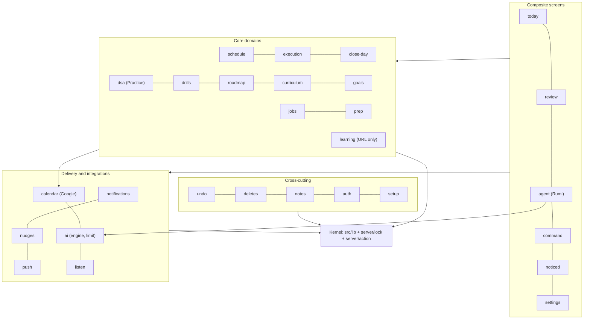

<!-- /diagram -->

## 3. Module architecture

Each feature folder follows the same recipe: `domain.ts` (pure functions and Zod schemas, unit-tested without a database), `service.ts` or split service modules (owner-scoped reads, writes inside `locked()`), `actions.ts` (`'use server'`, through `runAction`), `page-data.ts` (the page's loader) and components.

| Module                        | Responsibility                                                                                          | Main code                              | Depends on                                       |
| ----------------------------- | ------------------------------------------------------------------------------------------------------- | -------------------------------------- | ------------------------------------------------ |
| schedule                      | Routines, dated plans, blocks, generation today → Sunday, Prepare next week, block editing              | `features/schedule/`                   | kernel, calendar (sync soon)                     |
| execution                     | Sessions: start, pause, resume, complete; Focus                                                         | `features/execution/`                  | schedule                                         |
| close-day                     | Closing a day: each open block Done, Tomorrow or Let go; a check-in                                     | `features/close-day/`                  | schedule, execution                              |
| today                         | Today's loader and sections, the launcher, facts, Needs attention                                       | `features/today/`                      | schedule, execution, jobs, dsa, roadmap, noticed |
| dsa, drills                   | Practice: problems, append-only attempts, the 3/7/14 ladder, the pattern quiz                           | `features/dsa/`, `features/drills/`    | kernel                                           |
| roadmap, curriculum, goals    | Roadmaps by week, items and their revision, the default curriculum, goals                               | `features/roadmap/` etc.               | dsa (items follow Practice), learning            |
| learning                      | Learn subjects and topics (reachable by URL only)                                                       | `features/learning/`                   | kernel                                           |
| jobs, prep                    | Applications, stage history, rounds, the round's block, prep items, prep docs, invites, debriefs, mocks | `features/jobs/`, `features/prep/`     | schedule, roadmap, ai                            |
| review, look-back, day-print  | Weekly review, months of records, a print of a closed day                                               | `features/review/` etc.                | schedule, notifications                          |
| agent (Rumi)                  | Chat loop, tools, small writes, cards, memory, lines, voice, page context                               | `features/agent/`, `app/api/rumi/ask/` | ai, most features' services                      |
| ai, listen                    | Model calls, the ledger and the owner's monthly limit, the pinned provider check; Grill Me, Listen      | `features/ai/`, `features/listen/`     | kernel                                           |
| notifications, nudges, push   | The durable inbox, study nudges and Rumi's lines, Web Push delivery, retention                          | `features/notifications/` etc.         | schedule, review, agent                          |
| calendar                      | Google Calendar OAuth, sync (lease, push, pull, conflicts), webhook, watch channels                     | `features/calendar/`                   | schedule                                         |
| undo, deletes, notes, command | Undo kinds, deletes with Undo, quick notes, the ⌘K bar                                                  | `features/undo/` etc.                  | the features they act on                         |
| auth, settings, setup         | Sign-in, sessions, Settings' loader and sections, first-run steps                                       | `features/auth/`, `server/session.ts`  | kernel                                           |

The kernel: `src/lib/time.ts` (`dayKey`, `localInstant`, `repeatedInstant`, `dayBounds`, `hhmm`), `src/lib/day.ts` (`checkDay`, `shiftDay`, `weekDays`, `weekOf`, `isSunday`), `src/lib/categories.ts`, `src/lib/copy.ts` (`BANNED_WORDS`, `plural`), `src/lib/cookie.ts`, `src/lib/action-state.ts`, `src/server/lock.ts` (`locked`), `src/server/action.ts` (`runAction`, `failure`).

## 4. Database architecture

PostgreSQL 17 holds everything durable. The schema has 43 models, drawn below in seven groups. Every owner row carries `userId` with `ON DELETE CASCADE` from `User`, so the owner's data lives and goes together; links between records use `SET NULL` so deleting one record never deletes another owner record by accident.

Every owner table also carries `userId` → `User` with `ON DELETE CASCADE`; to keep the diagrams readable, that link is drawn only in the last two, where it is the only one.

### Planning and execution

<!-- diagram: er-plan -->

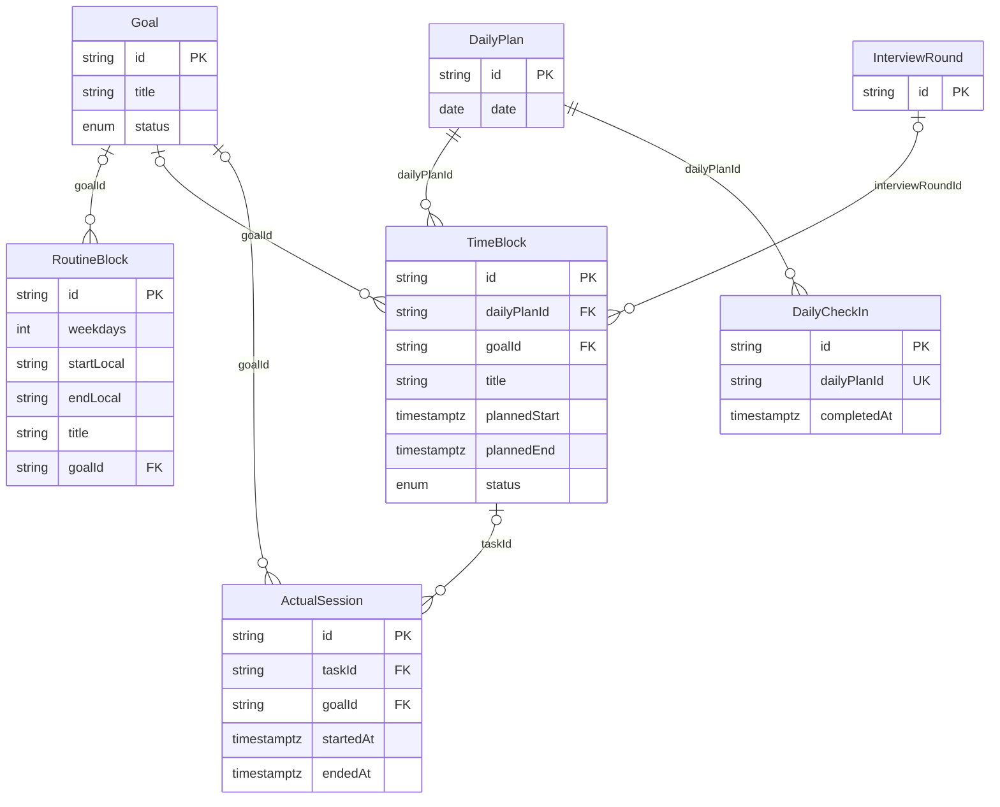

<!-- /diagram -->

### Review, notes and Google Calendar

<!-- diagram: er-review-calendar -->

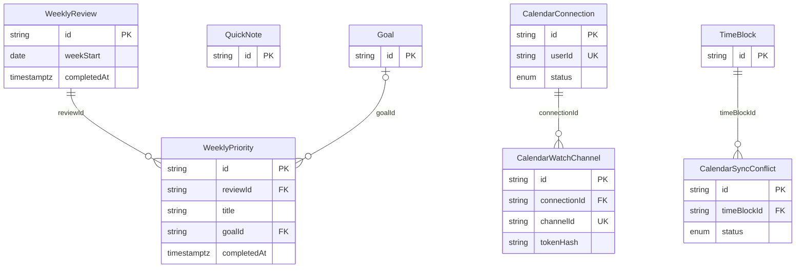

<!-- /diagram -->

### Practice

<!-- diagram: er-practice -->

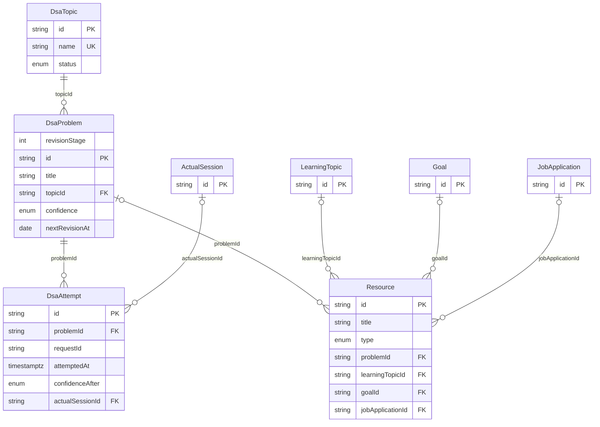

<!-- /diagram -->

### Roadmap and learning

<!-- diagram: er-roadmap-learning -->

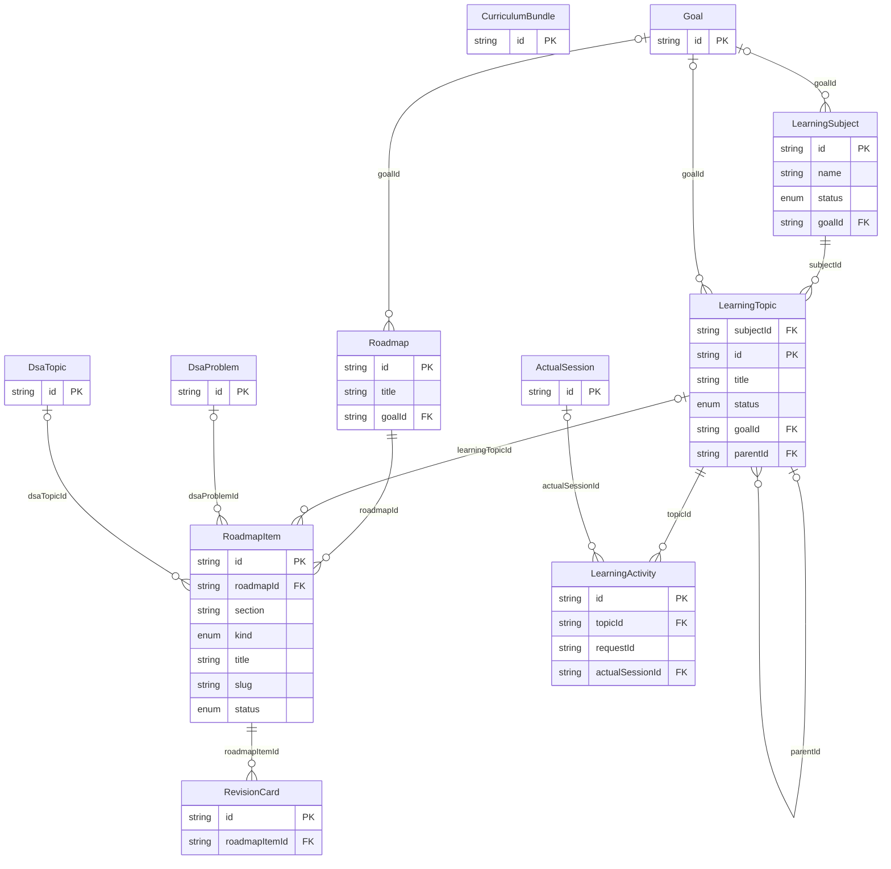

<!-- /diagram -->

### Jobs and interview preparation

<!-- diagram: er-jobs -->

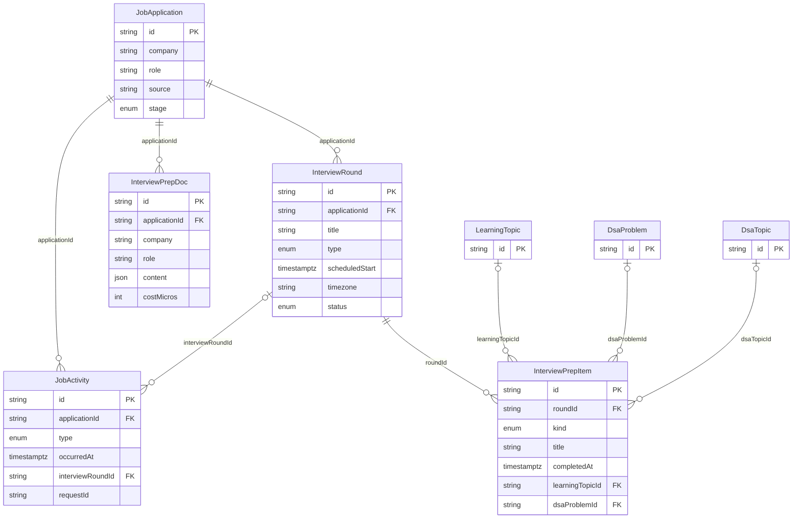

<!-- /diagram -->

### Rumi and AI

<!-- diagram: er-rumi -->

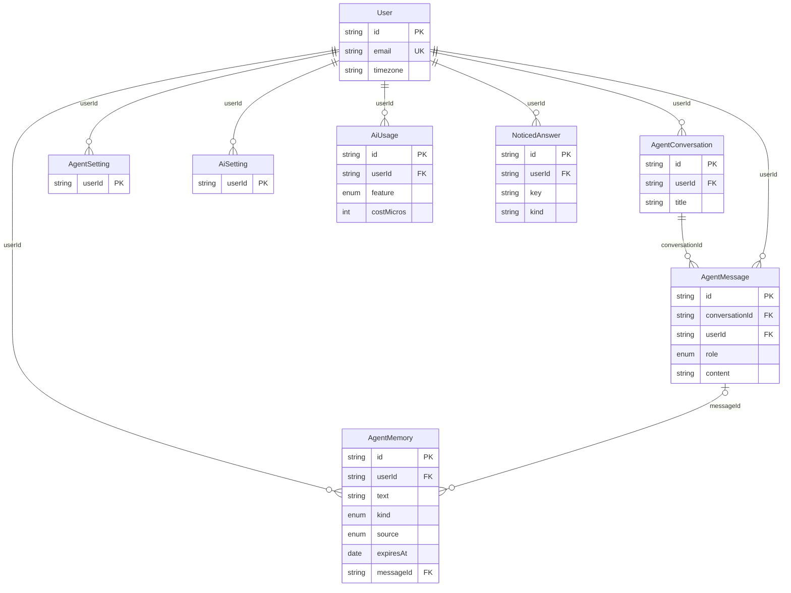

<!-- /diagram -->

### Sign-in, notifications and platform

<!-- diagram: er-platform -->

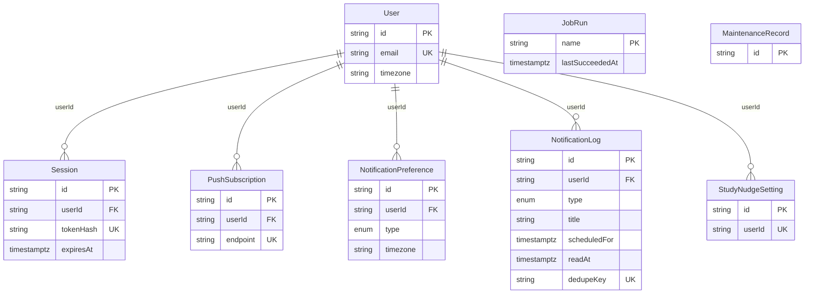

<!-- /diagram -->

### Constraints that carry the rules

| Rule                                                        | Where it is enforced                                                                                 |
| ----------------------------------------------------------- | ---------------------------------------------------------------------------------------------------- |
| A routine is generated once per day                         | `TimeBlock @@unique([routineKey, occurrenceDate])`                                                   |
| One plan per owner per day                                  | `DailyPlan @@unique([userId, date])`                                                                 |
| At most one running session per owner                       | partial unique index `one_running_session_per_user` on `ActualSession(userId) WHERE endedAt IS NULL` |
| A block ends after it starts; COMPLETED ⇔ completedAt       | `CHECK time_block_order`, `CHECK completion_consistency`                                             |
| A round has at most one block                               | `TimeBlock.interviewRoundId @unique`                                                                 |
| A retried attempt, activity or stage change is written once | `@@unique([userId, requestId])` on `DsaAttempt`, `LearningActivity`, `JobActivity`                   |
| A reminder is queued once                                   | `NotificationLog.dedupeKey @unique`                                                                  |
| An imported roadmap item is keyed by its slug               | `RoadmapItem @@unique([roadmapId, slug])`                                                            |
| Valid ranges                                                | `CHECK` on ratings, durations, revision stages, confidence vs independence, problem URLs             |
| One weekly review per week                                  | `WeeklyReview @@unique([userId, weekStart])`                                                         |

Indexes follow the reads: a day's blocks by `(dailyPlanId, plannedStart)` (WI-140), revisions due by `(userId, nextRevisionAt)`, the inbox by `(userId, readAt, scheduledFor)`, history by `(…, occurredAt)` and `(…, attemptedAt)`, sessions by `(userId, startedAt)`.

### Historical records and consistency

- `DsaAttempt`, `LearningActivity`, `JobActivity` and stage history are append-only; corrections are new rows.
- `TimeBlock` keeps its own copy of the routine's title and times (a snapshot); editing a dated block never touches its routine, and a routine edit reaches future days only through a previewed choice.
- A deleted block is cancelled with the reason `Deleted`, not removed, so the calendar sync can remove its Google event and Undo can bring it back.
- Every multi-row write runs in one transaction behind the owner lock. The calendar sync uses a lease on its connection row instead, because it calls Google between statements.
- Migrations are SQL files, never edited after they ship; CI checks drift with `prisma migrate diff --exit-code` and runs an upgrade test.

### Time

Instants (`plannedStart`, `startedAt`, `scheduledFor`, `sentAt`) are `timestamptz`; days (`DailyPlan.date`, `occurrenceDate`, revision and review dates) are `DATE`. Every connection is pinned to `TimeZone=UTC` and startup refuses otherwise. Local times become instants through `localInstant` (refuses a time that does not exist on a spring-forward day, for times typed for one day) and `repeatedInstant` (for thresholds such as a reminder's time or a day's midnight: a time in the gap is reached when the clock jumps; WI-145). A routine whose time falls in the gap is left out of that one day, never shifted (ADR-003). A legacy audit and a guarded one-time repair exist for data written before WI-005.1.

## 5. Data flows

### Level 0

<!-- diagram: dfd-level0 -->

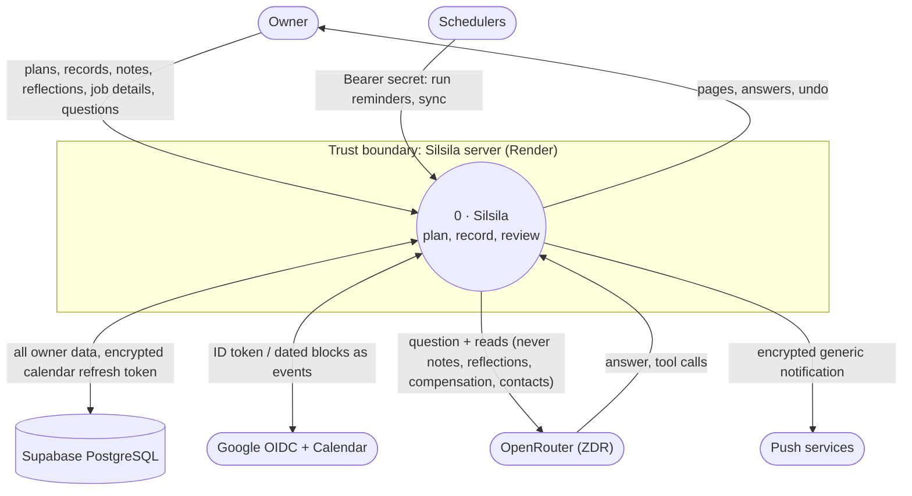

<!-- /diagram -->

### Level 1

<!-- diagram: dfd-level1 -->

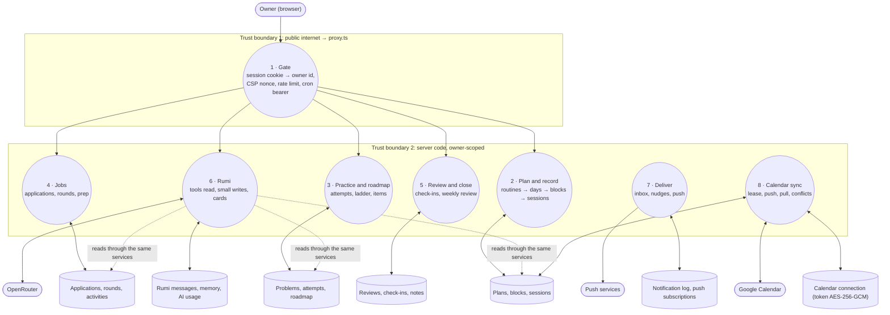

<!-- /diagram -->

**Trust boundaries.** (1) The public internet to `proxy.ts`: everything is untrusted until a session cookie's hash matches a live `Session`, or a cron request carries the bearer secret, or a webhook matches its channel id and token hash. (2) Server code to the database: every query is scoped by the owner id from the session. (3) The server to third parties: Google gets only the dedicated calendar's events; OpenRouter gets the question and owner-scoped reads stripped of private fields; push services get an encrypted payload with generic text.

**Sensitive flows.** Calendar refresh tokens are encrypted with AES-256-GCM before they are stored. Session tokens are stored only as SHA-256 hashes. Notes, reflections, compensation, contacts and job-description text never reach the model and never reach logs. Backups leave the database only as age-encrypted artifacts.

## 6. User flows

### Sign-in

<!-- diagram: flow-auth -->

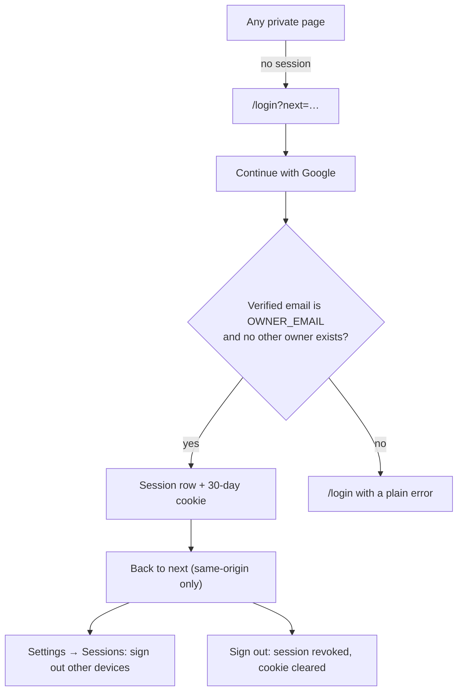

<!-- /diagram -->

### Today

<!-- diagram: flow-today -->

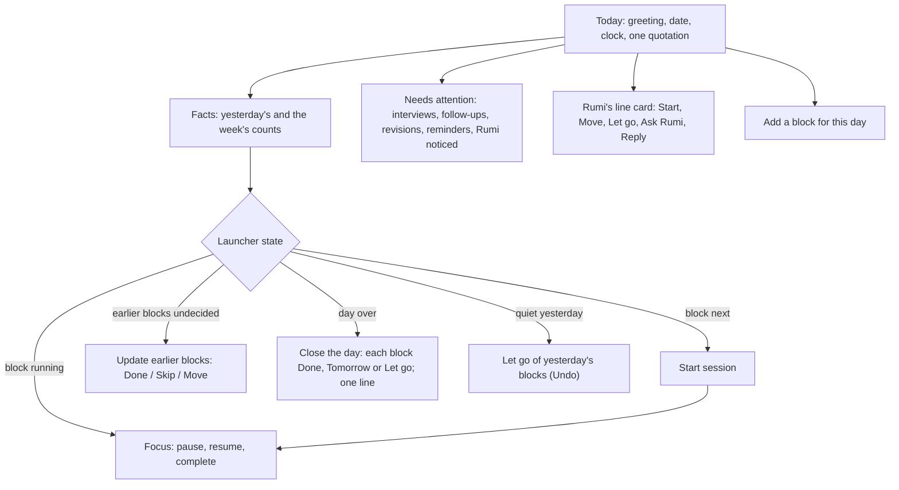

<!-- /diagram -->

### Plan

<!-- diagram: flow-plan -->

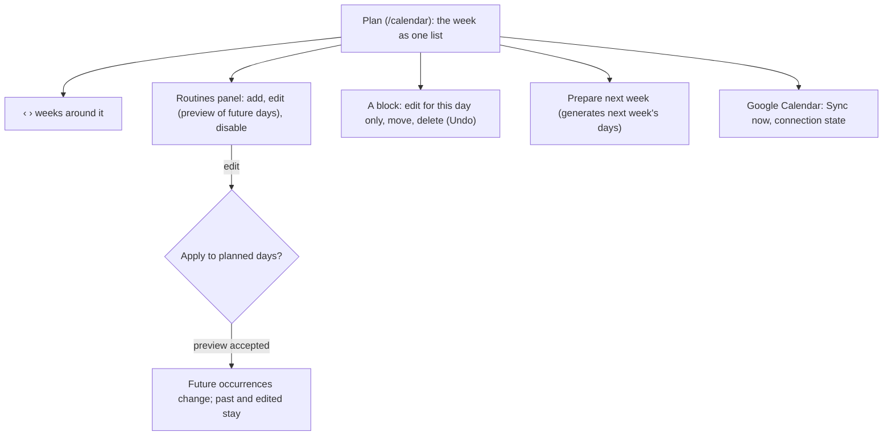

<!-- /diagram -->

### Roadmap

<!-- diagram: flow-roadmap -->

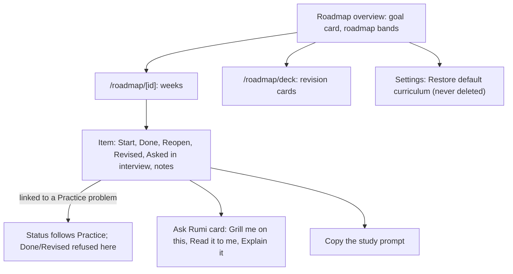

<!-- /diagram -->

### Practice

<!-- diagram: flow-practice -->

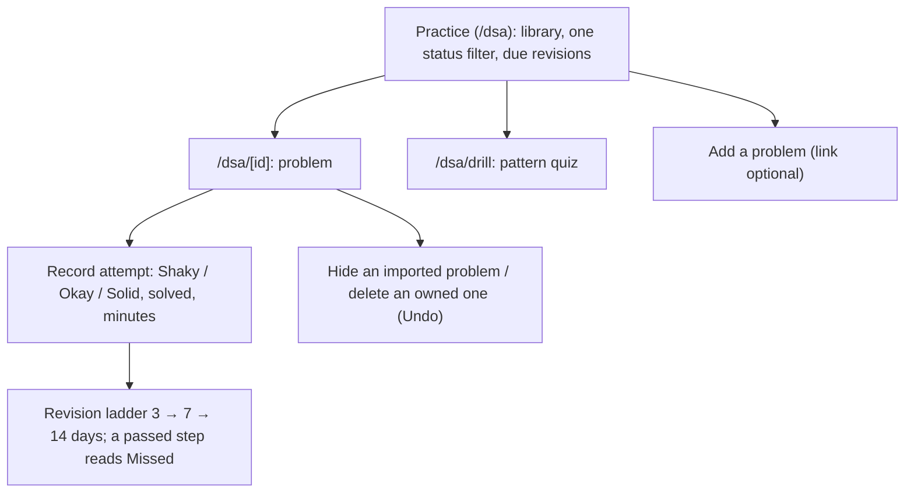

<!-- /diagram -->

### Jobs

<!-- diagram: flow-jobs -->

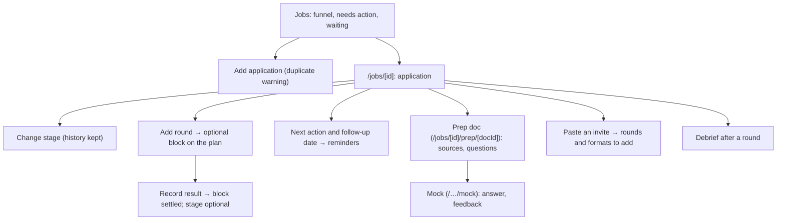

<!-- /diagram -->

### Weekly review

<!-- diagram: flow-review -->

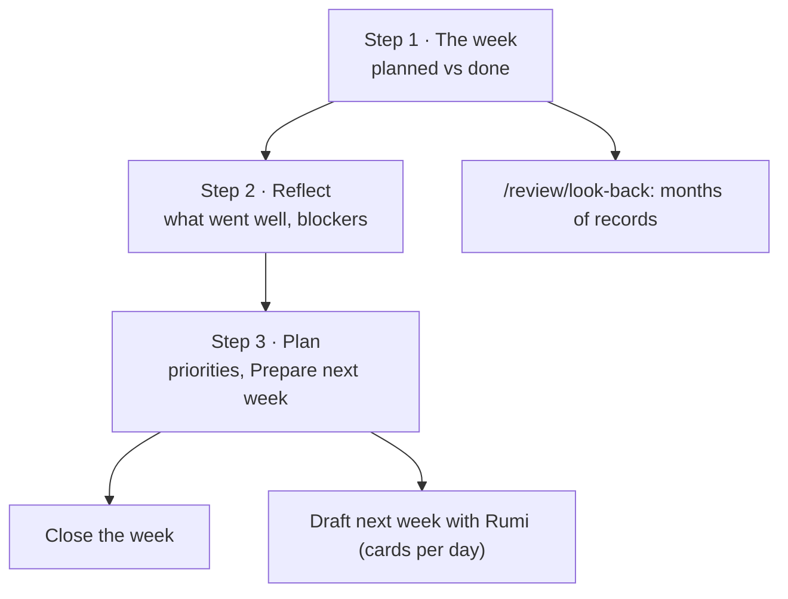

<!-- /diagram -->

### Settings

<!-- diagram: flow-settings -->

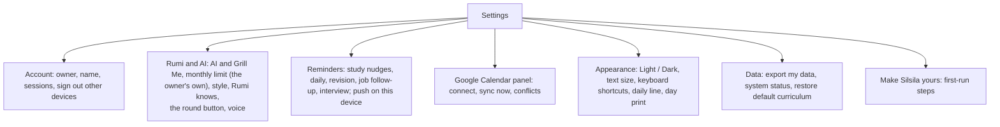

<!-- /diagram -->

### Ask Rumi

<!-- diagram: flow-rumi -->

```mermaid
flowchart TB
  E["Entry: round button, ⌘/, ⌘K, sidebar, line card, roadmap item, review"] --> D["Drawer or /rumi"]
  D --> Q["Type or Talk (voice after consent)"]
  Q --> R["Reads shown as they run"]
  R --> A{"Answer"}
  A -->|small write| W["Done at once: note, block in free time, rest day · Undo on the answer"]
  A -->|bigger change| C["Card: move/delete block, stage, attempt, review draft · Apply or Dismiss"]
  A -->|plan| P["Plan card for a day · Add the plan"]
  A -->|study| S["Explains like a study partner; spoken answers stay short"]
  Q --> M["Rumi knows: lines kept from the owner's own words, removable in Settings"]
```

<!-- /diagram -->

## 7. Sequences

### Sign-in and sessions

<!-- diagram: seq-auth -->

```mermaid
sequenceDiagram
  autonumber
  actor O as Owner
  participant L as /login (signInAction)
  participant G as Google OIDC
  participant CB as /api/auth/callback
  participant DB as PostgreSQL
  O->>L: Continue with Google
  L->>L: rate limit 20/min per IP · make state, nonce, PKCE verifier
  L->>O: Set encrypted login cookie (AES-256-GCM, path /api/auth, 10 min), redirect
  O->>G: authorize (openid email, S256 challenge)
  G->>CB: code + state
  CB->>CB: decrypt cookie, check state and expiry
  CB->>G: exchange code + verifier
  G-->>CB: ID token
  CB->>CB: verify signature, nonce, audience, verified email == OWNER_EMAIL
  CB->>DB: refuse if another owner exists · upsert User · insert Session(token SHA-256)
  CB->>O: httpOnly SameSite=Lax Secure cookie (30 days), redirect to next
  Note over O,DB: Every later request: proxy.ts resolves the cookie hash to a live Session (cached 60 s)
```

<!-- /diagram -->

### Planning and executing a block

<!-- diagram: seq-block -->

```mermaid
sequenceDiagram
  autonumber
  actor O as Owner
  participant T as Today / Plan page
  participant S as schedule service
  participant E as execution service
  participant DB as PostgreSQL
  O->>T: open Today
  T->>S: generateThroughSunday(today)
  S->>DB: count generated days (usually all done: one read)
  alt days missing
    S->>DB: lock owner row · per day upsert TimeBlock per routine<br/>unique(routineKey, occurrenceDate)
  end
  T-->>O: agenda, launcher, rings
  O->>E: Start session (Server Action)
  E->>DB: lock owner · insert ActualSession(endedAt null)<br/>partial unique: one running per owner
  O->>E: Pause / Resume / Complete in Focus
  E->>DB: end session · block status COMPLETED (planned and actual stay separate rows)
  E-->>O: runAction: message + Undo · snapshots dropped · pages revalidated
```

<!-- /diagram -->

### Recording a practice attempt

<!-- diagram: seq-practice -->

```mermaid
sequenceDiagram
  autonumber
  actor O as Owner
  participant P as /dsa/[id]
  participant A as dsa actions
  participant S as dsa service
  participant DB as PostgreSQL
  O->>P: open a problem
  P->>S: dsaSnapshot (memo 3 min) → settleRevisions: lapsed step → missed<br/>(guarded on the step it read)
  O->>A: Record attempt (confidence Shaky/Okay/Solid, solved, minutes)
  A->>S: recordAttempt(requestId)
  S->>DB: lock owner · append DsaAttempt (idempotent on requestId)
  S->>DB: update problem confidence and revision ladder (3 → 7 → 14 days)
  S-->>A: done · roadmap items linked to the problem follow Practice
  A-->>O: message + Undo
```

<!-- /diagram -->

### An interview round and its result

<!-- diagram: seq-jobs -->

```mermaid
sequenceDiagram
  autonumber
  actor O as Owner
  participant J as /jobs/[id]
  participant S as jobs services
  participant DB as PostgreSQL
  O->>J: Add interview round (date, time, zone, "on my plan" ticked)
  J->>S: scheduleRound
  S->>DB: lock owner · insert InterviewRound · JobActivity (append-only)
  opt on my plan
    J->>S: addInterviewToSchedule
    S->>DB: one TimeBlock for the round on that day (unique interviewRoundId)
  end
  O->>J: Record result (Completed / Cancelled / No-show, optional stage)
  J->>S: recordRoundResult(requestId)
  S->>DB: round status · JobActivity INTERVIEW_RESULT
  S->>DB: settle the linked block (refused while a session runs on it)
  opt stage chosen
    S->>DB: stage + JobActivity stage history (same transaction)
  end
  S-->>O: message + Undo · calendar syncs soon
```

<!-- /diagram -->

### Google Calendar sync

<!-- diagram: seq-calendar -->

```mermaid
sequenceDiagram
  autonumber
  participant C as Scheduler (Bearer)
  participant R as /api/calendar/sync
  participant S as calendar sync
  participant DB as PostgreSQL
  participant G as Google Calendar
  C->>R: POST every 5–15 min
  R->>S: syncCalendar(owner) per connection
  S->>DB: take the lease on CalendarConnection (busy → skip)
  S->>S: decrypt refresh token (AES-256-GCM), refresh access token (10 s timeout)
  S->>DB: generate today → Sunday (+ next week if prepared)
  S->>G: push pending blocks: insert / patch (etag) / delete Deleted blocks
  S->>G: pull changes with syncToken (410 → full sync)
  G-->>S: events with Silsila private properties only
  S->>DB: apply time edits to that dated TimeBlock only · record conflicts
  S->>DB: release lease, store syncToken, summary counts
  R->>DB: JobRun calendar-sync: success, or failure when every connection failed
  Note over G,R: Webhook /api/calendar/webhook: channel id + token hash verified, then the same sync runs after the response
```

<!-- /diagram -->

### Reminders, Rumi's lines and push

<!-- diagram: seq-notifications -->

```mermaid
sequenceDiagram
  autonumber
  participant C as Scheduler (every minute)
  participant R as /api/notifications/process
  participant N as processNotifications
  participant L as writeRumiLines
  participant P as deliverPending
  participant DB as PostgreSQL
  participant M as OpenRouter
  participant W as Push services
  C->>R: POST (Bearer CRON_SECRET)
  R->>N: per owner, under the owner lock
  N->>DB: due reminders and study nudges → NotificationLog (unique dedupeKey)
  R->>L: outside every lock: one pending Rumi line
  L->>DB: reads by code (today, activity, jobs)
  L->>M: one short line (pinned provider, ZDR)
  M-->>L: line → checked (length, banned words, numbers must exist) or template kept
  R->>P: deliver up to 100 pushes
  P->>W: encrypted payload, generic lock-screen text
  W-->>P: 201 / 404-410 gone / 429-5xx retry (max 3 attempts)
  R->>R: daily jobs, each on its own: provider check, memory prune, nudge times, retention
  R->>DB: JobRun notifications (counts only)
```

<!-- /diagram -->

### Weekly review

<!-- diagram: seq-review -->

```mermaid
sequenceDiagram
  autonumber
  actor O as Owner
  participant V as /review
  participant S as review service
  participant DB as PostgreSQL
  O->>V: open Weekly review
  V->>S: reviewPage(week) through its loader
  S-->>O: Step 1 · The week: planned versus done per day and category
  O->>S: Step 2 · Reflect: what went well, blockers (saveReview, a draft)
  O->>S: Step 3 · Plan: next week's priorities (addPriority, movePriority)
  O->>S: Prepare next week
  S->>DB: lock owner · generate next week's days from routines (idempotent)
  O->>S: Close the week (completeReview)
  S->>DB: WeeklyReview completed · open revisions and follow-ups listed as Still open
  S-->>O: message + Undo · calendar sync pushes next week's blocks
```

<!-- /diagram -->

### Ask Rumi

<!-- diagram: seq-rumi -->

```mermaid
sequenceDiagram
  autonumber
  actor O as Owner
  participant D as Rumi drawer (client)
  participant R as POST /api/rumi/ask
  participant A as agent service
  participant AI as ai engine (ledger)
  participant M as OpenRouter
  participant DB as PostgreSQL
  O->>D: question (typed or Talk)
  D->>R: JSON {conversationId, text, voice, page}
  R->>R: same-origin check, owner(), Zod, 4,000 chars max
  R->>A: askRumi (stream lines as they happen)
  A->>DB: history window, memory lines, page record as data
  loop at most MAX_ROUNDS
    A->>AI: reserve cost under the owner lock (monthly limit if the owner set one)
    AI->>M: chat + tools (pinned provider, zdr, cached system prompt)
    M-->>AI: text or tool calls
    AI->>DB: settle AiUsage (tokens, micros)
    alt read tool
      A->>DB: owner-scoped read · ids remembered
      A-->>D: {"read":"get_today"}
    else small write (note, block, rest day)
      A->>DB: lock owner · write through the feature service · action + Undo
      A-->>D: {"write":"add_note"}
    else bigger change
      A->>A: card stored on the answer · the owner presses Apply later
    end
  end
  A->>DB: store the answer with actions, cards, seen ids
  A-->>D: {"done": answer} then {"kept": memories}
  Note over A,DB: A model failure after a write still stores the answer with its Undo (WI-145)
```

<!-- /diagram -->

## 8. Deployment

<!-- diagram: deployment -->

```mermaid
flowchart TB
  user(["Owner's browsers<br/>Chrome, Safari, Home Screen app"])
  dns["usesilsila.me<br/>HTTPS, HSTS"]
  subgraph renderbox["Render (Ohio) · free web service"]
    container["Docker image from this repo<br/>next start · Node 24<br/>health check /api/health"]
  end
  subgraph supa["Supabase (Canada Central) · free"]
    pg[("PostgreSQL 17<br/>session pooler, TLS no-verify")]
  end
  gh["GitHub Actions<br/>Quality (CI) → Render deploys main<br/>daily encrypted backup · weekly WebKit<br/>scheduler every 15 min · uptime hourly"]
  cronorg["cron-job.org<br/>reminders every minute<br/>calendar sync every 5–15 min"]
  better["Better Stack<br/>keyword monitor on /api/health"]
  google["Google OIDC + Calendar"]
  orouter["OpenRouter → Vertex (ZDR)"]
  user --> dns --> container
  container --> pg
  container --> google
  container --> orouter
  cronorg --> container
  gh --> container
  gh -. "pg_dump → age-encrypted artifact" .-> pg
  better --> container
```

<!-- /diagram -->

| Concern          | How it works                                                                                                                                                  | Verified from                                                        |
| ---------------- | ------------------------------------------------------------------------------------------------------------------------------------------------------------- | -------------------------------------------------------------------- |
| Runtime          | Render free web service, Docker image from this repository, Ohio, `next start`; deploys `main` only after the Quality workflow passes                         | `Dockerfile`, `docs/engineering/deployment.md`, ADR-014              |
| Database         | Supabase free PostgreSQL 17, Canada Central, session pooler, TLS with `DATABASE_SSL=no-verify`                                                                | `.env.example`, deployment guide                                     |
| Domain and HTTPS | `usesilsila.me`; HSTS and a nonce CSP from `src/server/security.ts`                                                                                           | code; a public GET of `/privacy` on 2026-11-02                       |
| Configuration    | Environment variables validated at startup by `src/lib/env.ts`; production refuses to start with a missing or invalid value and never prints values           | code                                                                 |
| Scheduled work   | cron-job.org: `/api/notifications/process` every minute, `/api/calendar/sync` every 5–15 minutes; a GitHub Actions caller every 15 minutes as a second caller | `docs/engineering/operations.md`, `.github/workflows/scheduler.yml`  |
| Health           | `/api/health`: database, session time zone, schema version, jobs fresh or stale; Render's health check and Better Stack read it                               | code; dashboards are outside the repository                          |
| Backups          | Daily GitHub Actions dump, restore-checked, encrypted with age to the owner's public key; the owner's monthly recovery drill (`scripts/restore-drill.sh`)     | `.github/workflows/backup.yml`, `docs/engineering/backup-restore.md` |
| Migrations       | Applied from the workstation to Supabase before the merge, after a verified backup                                                                            | operations runbook                                                   |

The Render and Supabase dashboards, cron-job.org and Better Stack are configured outside the repository; their settings above come from the runbooks, not from inspection of those dashboards.

## 9. Security architecture

- **Authentication.** Google OIDC with PKCE (S256), state and nonce in an AES-256-GCM encrypted, path-scoped, 10-minute cookie; `openid email` scope only; the verified email must equal `OWNER_EMAIL`; a database with another owner refuses sign-in.
- **Sessions.** A random token in an httpOnly, SameSite=Lax, Secure (over HTTPS) cookie for 30 days; only its SHA-256 hash is stored; sign-out revokes the row; Settings signs out other devices; resolved sessions are cached for 60 seconds.
- **Authorisation.** One owner: every page, action and private API calls `owner()`, and every query filters by that id. Owner-scoping tests run per area (`*-security.test.ts`), including Rumi's tools, cards and undo payloads.
- **Request protection.** `proxy.ts` gates private routes (redirect to `/login`, 401 for APIs); Server Actions keep Next's same-origin check; the Rumi stream checks `Origin` against `Host`; a nonce-based CSP with `strict-dynamic`; HSTS; rate limits on sign-in, the callback, the webhook and the health check.
- **Integrations.** Calendar refresh tokens encrypted with AES-256-GCM (`CALENDAR_TOKEN_ENCRYPTION_KEY`, 16-byte tag enforced); only the app-created calendar is read or written; the webhook checks channel id and a token hash; push subscriptions must point at a known browser push service; the AI provider is pinned and its zero-retention listing is checked daily.
- **Secrets.** Environment only, validated without printing; nothing `NEXT_PUBLIC_`; cron endpoints need `Authorization: Bearer $CRON_SECRET`; backups encrypted to a public key so the repository holds no private key.
- **Logs.** A fixed vocabulary (`docs/engineering/security.md`): error classes, codes, counts and short references, never tokens, personal text or contacts.

## 10. Reliability and operations

- **Idempotency.** Unique keys make generation, attempts, activities, stage changes and reminders safe to retry; both cron endpoints are safe to call twice or concurrently.
- **Concurrency.** The owner row lock serialises an owner's writes; the calendar uses a lease; the one-running-session index stops two sessions even under a race.
- **Partial failure.** A Rumi answer that fails after a change still stores the change with its Undo (WI-145). Each daily job beside the reminders runs on its own (WI-145). Push failures never remove inbox rows. A follow-up after a committed action (a calendar sync) never turns the action into a failure.
- **Timeouts.** The pool cancels a statement after 15 seconds; each Google request attempt times out after 10 seconds; the model call has its own timeout.
- **Detection.** `/api/health` reports `jobs: ok | stale` from `JobRun` freshness; a calendar run where every connection failed now counts as a failure, so it turns stale (WI-145). Server errors are logged with the reference the error page shows.
- **Recovery.** Daily encrypted backups with a restore check; the owner's monthly drill (`scripts/restore-drill.sh`), not yet timed; up to a day of writes can be lost (Supabase Free keeps no provider backups).

## 11. Performance

- Every statement is a cross-region round trip (Ohio to Canada Central), so pages are designed by statement count: `currentSession` is request-cached, read-only snapshots go through a three-minute in-process cache (`src/server/memo.ts`) dropped by every write, Today's Needs attention streams behind its own Suspense boundary, links prefetch only on intent.
- Generation is skipped with one count query when the week is already planned.
- The model's system prompt and tools are sent as cached blocks (WI-143).
- Zod is kept out of client bundles except on seven form pages; the shell, `/privacy` and Today ship without it.

## 12. Decisions and trade-offs

| Decision                                | Chosen                                                                                                                               | Alternatives                                             | Why                                                               |
| --------------------------------------- | ------------------------------------------------------------------------------------------------------------------------------------ | -------------------------------------------------------- | ----------------------------------------------------------------- |
| Shape (ADR-001)                         | Modular monolith on PostgreSQL                                                                                                       | Services, a BaaS                                         | One owner, one transaction boundary, simplest operations          |
| Planned vs actual (ADR-002)             | Separate templates, dated snapshots and sessions                                                                                     | One "task" with a done flag                              | The gap between plan and record is the product                    |
| Time (ADR-003, ADR-009)                 | DATE labels, UTC instants, UTC sessions                                                                                              | Store local times, or everything as timestamps           | DST and day boundaries stay correct; a legacy repair existed once |
| Concurrency (ADR-004)                   | Owner row lock + unique keys                                                                                                         | Optimistic retries, a queue                              | Few writers, so serialising is cheap and simple                   |
| Access (ADR-005, ADR-012)               | Google OIDC, one allowlisted owner, server sessions                                                                                  | Passwords, JWT sessions                                  | No password storage; revocable sessions                           |
| Calendar (ADR-010)                      | Only an app-created calendar, dated blocks only                                                                                      | Two-way sync with the main calendar                      | Never touch the owner's other events                              |
| Cache (ADR-017)                         | Three-minute in-process snapshots dropped on writes                                                                                  | Redis, no cache                                          | Free tier, one instance, round trips dominate                     |
| Hosting (ADR-013, ADR-014)              | Docker on Render + Supabase free                                                                                                     | Heroku (credit pending), a VPS                           | Zero cost, portable image                                         |
| AI (ADR-021, ADR-022, ADR-024, ADR-030) | One pinned model with zero data retention; reads first, small writes with Undo, bigger ones as cards; a monthly limit the owner sets | Free models that may train on prompts, autonomous writes | Privacy and reversibility over autonomy                           |
| Styling (WI-135, WI-137)                | Tailwind for new UI, the old stylesheet below it                                                                                     | A big rewrite                                            | Change pages when they are next touched                           |

## 13. Interview preparation

### 30-second introduction

Silsila is a full-stack app I built and run in production at usesilsila.me. It is a personal execution system for interview preparation: it turns weekly routines into dated plans, records what actually happened, runs DSA practice on spaced revision, tracks job applications and interview rounds, and closes each week with a review. It is Next.js 16 with React Server Components and Server Actions on PostgreSQL through Prisma, deployed as a Docker image on Render with Supabase, with Google sign-in, Google Calendar sync, Web Push, and an AI assistant that reads my records but cannot see private fields.

### 2-minute architecture explanation

It is a modular monolith: one container and one database. Every request goes through a proxy that resolves the session from a hashed token, sets a CSP nonce, and rate-limits public endpoints. Pages are Server Components that read through feature loaders; forms are Server Actions that run through one action runner, which resolves the owner, validates with Zod, writes inside a transaction that locks the owner's row, then invalidates a small in-process cache and returns an Undo. The core domain separates templates, dated plans, planned blocks and actual sessions, so planned and actual time never overwrite each other. Days are SQL DATEs and instants are UTC timestamps, and every database session is pinned to UTC. Scheduled work is two idempotent HTTP endpoints called by external schedulers: one builds the reminder inbox and delivers push, the other syncs a dedicated Google calendar with a lease. The assistant calls a pinned model with zero data retention; its tools are owner-scoped reads, small writes that carry an Undo, and cards for bigger changes the owner applies.

### 5–10-minute technical walkthrough

1. **The problem and the core model** (1 min). Routine → DailyPlan → TimeBlock → ActualSession. Generation is idempotent on `(routineKey, occurrenceDate)` and fills today to Sunday when Today or Plan is viewed; next week is prepared on purpose.
2. **Request path** (1 min). `proxy.ts` → Server Component → `page-data.ts` loader → services; Server Actions through `runAction` (owner, Zod, `locked()`, error classes, references, revalidation).
3. **Data integrity** (2 min). The owner lock, unique keys for retries, the partial unique index for one running session, CHECK constraints, append-only history, Undo payloads validated per kind and owner.
4. **Time** (1 min). DATE vs `timestamptz`, the UTC session pin, DST: a typed time that does not exist is refused, a routine in the gap is left out of that one day, and a reminder in the gap is due when the clock jumps.
5. **Integrations** (2 min). Google OIDC with PKCE; Calendar sync with a lease, etags, a sync token, conflicts recorded and only the dedicated calendar touched; Web Push as a channel over a durable inbox; the AI engine with a ledger, a pinned zero-retention provider checked daily, and a monthly limit the owner sets.
6. **Rumi** (1 min). A tool loop with a round cap, reads streamed as NDJSON, writes only on ids the conversation has read, two write classes (at once with Undo, or a card), memory kept only from the owner's own words.
7. **Operations and testing** (1 min). CI gate (lint, types, unit and database tests, build, e2e with axe, docs links), daily encrypted backups, health with job freshness, owner-scoping tests and a boundaries test that keeps the architecture honest.

### Key engineering challenges

- **DST and day boundaries.** Solved with DATE labels, UTC sessions and two explicit conversions; tests cover both transitions.
- **Idempotent scheduling without a queue.** Unique dedupe keys and the owner lock make every cron run safe to repeat.
- **Two-way calendar sync without touching other events.** A dedicated calendar, private properties on events, a lease and etags.
- **An assistant that can change data safely.** Owner-scoped tools, a seen-id rule, write caps, Undo on every write, cards for anything bigger, and the change kept even if the model fails afterwards.

### Likely follow-up questions

**Why a monolith and not microservices?** One owner and one database: a monolith gives one transaction boundary and no network between modules. Modularity is enforced in code instead (feature folders, a kernel, a boundaries test).

**How do you stop two sessions running at once?** A partial unique index on `ActualSession(userId) WHERE endedAt IS NULL`, so even a race loses at the database, plus the owner lock in the service.

**How do retries not duplicate data?** Each write that can be retried carries a request id or a natural key with a unique constraint (`requestId`, `dedupeKey`, `routineKey + occurrenceDate`).

**How do you handle time zones?** Days are DATE labels, instants are UTC, sessions are pinned to UTC, and the owner's zone converts between them at the edges. A spring-forward time typed for one day is refused; a routine in the gap is left out of that day, never shifted; a reminder in the gap is due when the clock jumps.

**What does the AI see?** Owner-scoped reads through the same services; never notes, reflections, compensation, contacts or job descriptions. The provider is pinned with zero data retention and checked daily; the owner sets the monthly limit.

**What happens if Google or the model is down?** Calendar errors are recorded on the connection with backoff; a run where all connections fail turns the job stale on the health check. A model failure after a change keeps the change and its Undo; without a change the owner sees a plain message.

**How is it secured?** OIDC with PKCE, an allowlisted owner, hashed server sessions, nonce CSP, HSTS, rate limits, encrypted tokens, bearer-protected cron, owner-scoping tests, a fixed log vocabulary.

**How would it scale to many users?** Add tenancy to every query (already owner-scoped), move rate limits and the cache to shared storage, move scheduled work to a job runner, and put the app and database in one region.

**What would you change?** Put the app and database in one region, move off free tiers, add error tracking, and keep shrinking the remaining feature cycles.

### Known limitations to state honestly

Single owner; free-tier latency and limits; in-memory rate limits; browser-dependent voice; real-device iPhone checks are manual; the logo artwork is provisional.

## Appendix: inventory (2026-11-02)

23 pages, 11 route handlers, 26 Server Action files with 120 exported actions, 90 client components, 31 feature folders, 43 models, 29 enums, 35 migrations (latest `20261107000000_time_block_plan_index`), 386 TypeScript files and about 68,700 lines in `src/` (with CSS), 161 Vitest files, 21 Playwright journeys.
