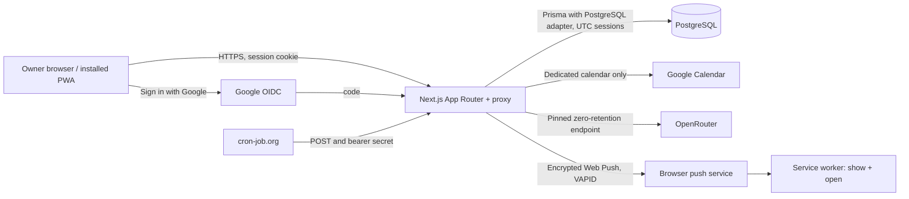

# Architecture

## Scope and runtime

Silsila is a modular monolith: one Next.js application, one PostgreSQL database, and an external scheduler calling two protected endpoints. The trust model is one allowlisted Google account, not tenant isolation. There is no queue, Redis or worker. External systems: Google (sign-in, and the optional dedicated Calendar), browser push services, and OpenRouter for AI (one pinned zero-retention endpoint, ADR-022; the `web` plugin's Exa search sees only fixed search words, ADR-024).

Production runs on a Render free web service (Ohio) with Supabase free PostgreSQL 17 (Canada Central), ADR-014; every statement is a cross-region round trip, so pages keep their statement count low ([measuring a page's queries](../engineering/operations.md#measuring-a-pages-queries)). The scheduler is a deployment requirement, not an in-process timer ([deployment guide](../engineering/deployment.md), [security](../engineering/security.md)).

## Code layers

| Layer           | Responsibility                                                                                                         | Where                                                                                                 |
| --------------- | ---------------------------------------------------------------------------------------------------------------------- | ----------------------------------------------------------------------------------------------------- |
| Request gate    | Session, cron bearer, CSP nonce, rate limits, public paths                                                             | `src/proxy.ts`, `src/server/session.ts`, `src/server/security.ts`, `src/server/rate-limit.ts`         |
| Configuration   | Validated environment, fail-fast at start, UTC check                                                                   | `src/lib/env.ts`, `src/instrumentation.ts`, `src/lib/database.ts`                                     |
| Routes          | Server-rendered pages and API handlers                                                                                 | `src/app/**`                                                                                          |
| Shared UI       | Shell, `ActionForm`, `SidePanel`, `Disclosure`, `MoreMenu`, `Button`, toasts                                           | `src/components/`                                                                                     |
| Feature actions | Resolve the owner, validate, call services, revalidate                                                                 | `src/features/<feature>/actions.ts`                                                                   |
| Kernel          | Day labels, categories, copy rules, the owner lock, the action runner; imports no feature (`tests/boundaries.test.ts`) | `src/lib/day.ts`, `categories.ts`, `copy.ts`, `time.ts`, `src/server/lock.ts`, `src/server/action.ts` |
| Pure rules      | Dates, recurrences, overlaps, view models, AI input and output checks; no database, Next or React                      | `src/features/<feature>/domain.ts` and `*-domain.ts`                                                  |
| Services        | Owner-scoped reads (memoized snapshots) and transactional writes under the owner lock                                  | `src/features/<feature>/service.ts`                                                                   |
| AI engine       | One reserve, call, check and settle path for every model call; the ledger; the provider check                          | `src/features/ai/`                                                                                    |
| Platform        | Database client, owner lookup, memo cache, health, job runs, export                                                    | `src/server/`                                                                                         |
| Storage         | Schema, immutable SQL migrations, example seed                                                                         | `prisma/`                                                                                             |

Server Components are the default. Client components hold navigation state, form feedback, push and voice controls, error recovery, and the richer islands that need them (Focus, the Rumi drawer and chat, the command bar, a roadmap week). There are no client data stores; `localStorage` and `sessionStorage` keep only per-device conveniences (a remembered band, a form draft). Feature by feature, see [features](features.md).

## Read and write contracts

A page resolves the signed-in owner (`owner()` → session → user) before querying. A Server Action resolves the owner again and never accepts a user id from the browser. Zod parses allowlisted fields. Services serialize multi-row writes with a row lock on the owner's `User` row (`locked()` in `src/server/lock.ts`, `SELECT … FOR UPDATE` inside a Prisma transaction) and commit or roll back as one. Calendar sync uses a lease on its connection row so cron, the webhook and "Sync now" never interleave, and remote calls never run inside a transaction. Views are revalidated, and the memoized snapshots dropped (`forgetAll`), only after success.

Routine and block edits carry `updatedAt` versions, and routine propagation needs a fresh server-computed preview. The single-open-session partial index guards concurrent starts. Rumi's writes run through the same writers under the same lock; its cards re-check their snapshot under the lock when the owner presses them (ADR-030).

## Domain invariants

The full list is in `CLAUDE.md` ("Core domain invariants"). In short: weekly templates, dated plans and actual sessions are different facts; `(routineKey, occurrenceDate)` identifies an occurrence even after it moves; generation is idempotent and fills today to Sunday; one running session per owner; attempts, activities, job activities and stage history are append-only; the roadmap never writes to Practice or Learn; overdue is a display state, never evidence that work was skipped.

## Time storage

Silsila stores two kinds of time and never mixes them (ADR-003, ADR-009):

- **Instants** (`timestamptz`): `ActualSession.startedAt/endedAt`, `TimeBlock.plannedStart/End`, `InterviewRound.scheduledStart/End`, notification times and every `createdAt`/`updatedAt`. They are processed in **UTC database sessions** and converted to the owner's IANA zone only at the display and domain boundary (`America/Toronto` today).
- **Owner-calendar dates** (`DATE`): `DailyPlan.date`, revision dates, review dates, `JobApplication.appliedAt/nextActionDate`, `Goal.targetDate`. These are labels, never instants, and never pass through `new Date(...)` UTC arithmetic.

`@prisma/adapter-pg` sends a `Date` as its UTC wall clock without an offset and discards the offset on read; both steps are exact only in a UTC session. `src/lib/database.ts` therefore adds `-c TimeZone=UTC` to every connection, for the app, migrations, seed, scripts and tests, and `src/instrumentation.ts` refuses to start when the app session is not UTC. If a transaction-mode pooler drops startup options, set `ALTER DATABASE … SET TimeZone = 'UTC'`. Wall-clock input is converted with the IANA rules for its own date (`localInstant`); a nonexistent spring-forward time is rejected. The guarded legacy repair is in [operations](../engineering/operations.md#legacy-timestamp-repair).

## Failure boundaries

A failed mutation returns a message beside its button (or a toast) and the transaction keeps the prior data. An invalid DST time aborts that day's generation. A stale preview must be requested again. A running session survives restarts. A database outage shows the route's error state; `/api/health` returns 503 when the database is unreachable, the session is not UTC or the expected migration is missing, so Render refuses a deploy whose migration was not applied. A cron failure returns 500 and is recorded in `JobRun`; a stale job shows in `/api/health` and in Settings. An AI failure keeps the deterministic fallback (a template line, no card), and a provider other than the pinned one blocks AI until the owner checks again.

## Extension rules

Add new use cases inside the existing feature folders, with pure rules in a domain file and writes in a service under the owner lock. Keep categories user-defined. Add an ADR before changing authentication or tenancy, timezone handling, execution concurrency, storage ownership, what reaches an AI model, or a new delivery channel. Calendar sync keeps Silsila's planned blocks as the source of truth (ADR-010).
