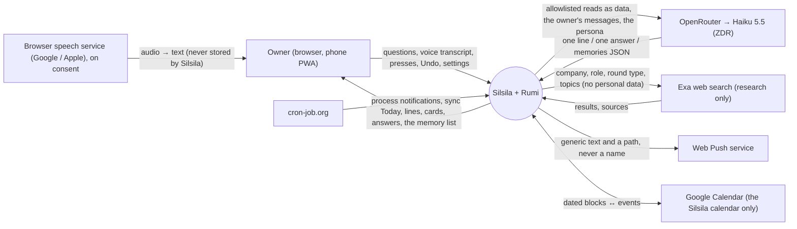
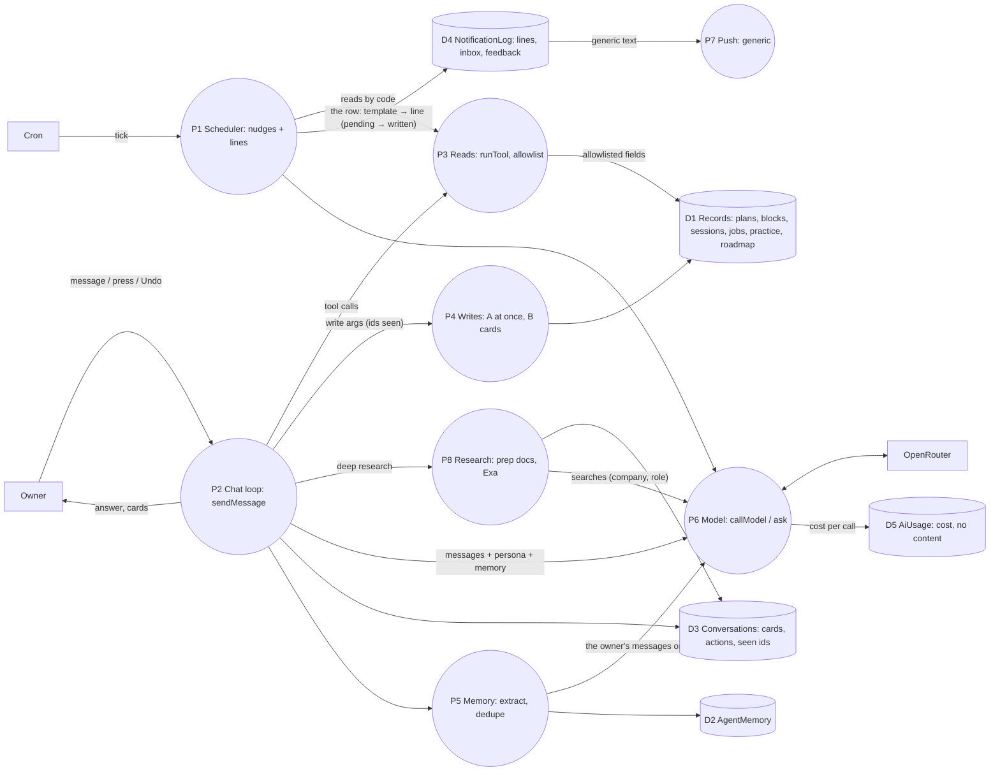
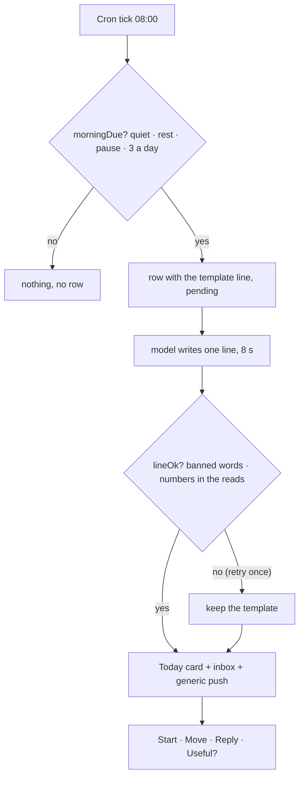
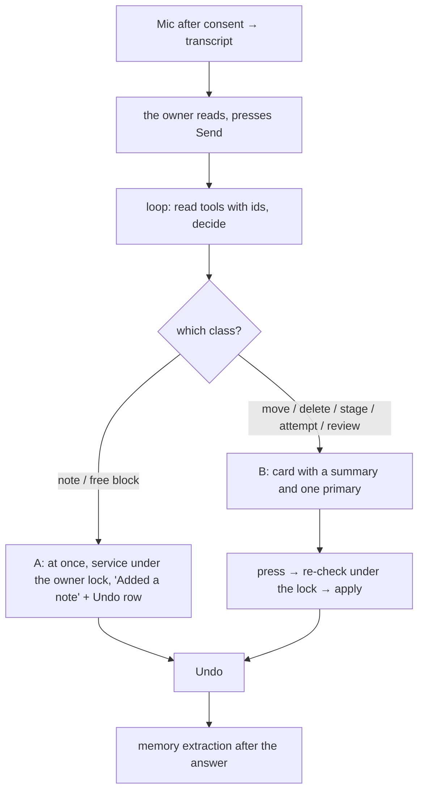
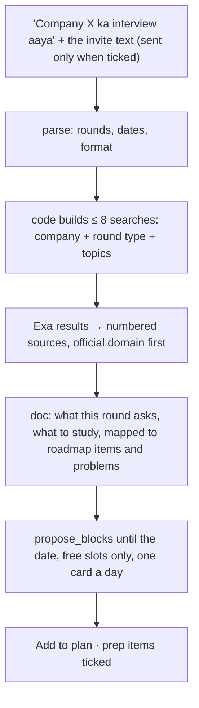
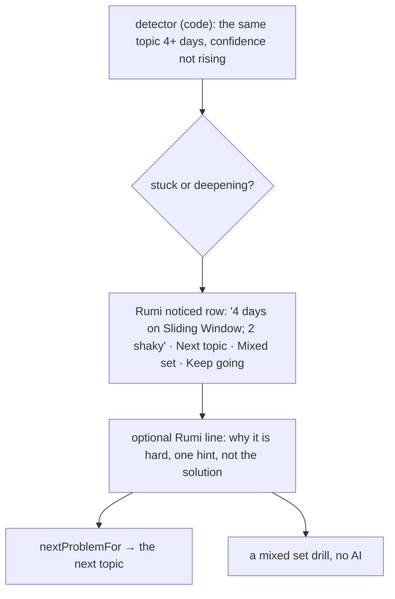
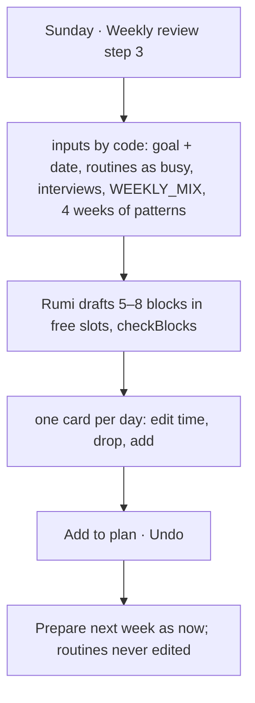

# Rumi 2 and 3: architecture, data flow and user flows

Companion to [the Rumi 2 and 3 plan](../product/rumi2-plan.md) and ADR-030 in [decisions](decisions.md). The diagrams are Mermaid; the owner's approved pictures are `output/Silsila-Rumi-2-Architecture.pdf` (not committed).

## 1. The shape, borrowed from Muse

Meta's Muse (September 2026) is a personal agent in five layers: channels (app, WhatsApp, glasses), an agent runtime (a cloud VM per user with host-side credentials and a safety supervisor), a model (Muse Spark: multimodal, tools, parallel agents), a memory the user can view and edit, and tools that act (browse, connected apps, email, purchases) with confirmation before consequential actions, plus a proactivity dial. Rumi keeps the shape and changes what sits in each layer: the orchestrator and the policy are deterministic code with tests, the model is one small pinned model on a zero-retention endpoint, the tools reach only the owner's own records, and Rumi never signs into the owner's accounts. The web is used for research only (Exa, code-built queries), never with the owner's personal data.

## 2. Rumi's layers in Silsila

```mermaid
flowchart TB
  subgraph Channels
    C1[Today: Rumi's line card]
    C2[Drawer and /rumi chat]
    C3[Push: generic text only]
    C4[Voice in and out: browser APIs]
  end
  subgraph Orchestrator["Orchestrator (code decides)"]
    O1["Scheduler: processNotifications → morningDue / middayDue / recapDue, quiet hours, pause, rest, 3 lines a day, fallback template; the model call runs outside the owner lock"]
    O2["Chat loop: sendMessage, 6 tool rounds, 12-message history, seen ids, ≤ 2 writes per answer, the last round answers only"]
  end
  subgraph Policy["Policy (ADR-021, 022, 024, 030)"]
    P1["Allowlist reads; never-read list (notes, check-in notes, reflections, compensation, contacts); non-study blocks as busy; test records and Study-AI-off roadmaps out"]
    P2["Two write classes; owner lock; Undo; caps (the owner's monthly limit since WI-114, 30/h, 100/d, 3 lines/d); banned words and invented-number check; provider must be Google or AI is off"]
  end
  subgraph Tools["Tools (the only way to data)"]
    T1["Reads: get_today, get_schedule, get_activity, get_roadmaps, get_practice, get_jobs, get_patterns, get_prep_docs, find_problems (with ids)"]
    T2["Writes A, at once + Undo: add_note, add_block (free slot), rest_today"]
    T3["Writes B, card + one press: move_block, delete_block, change_stage, log_attempt (no Undo), write_review"]
    T4["Research, outside the loop: prep docs and the interview-invite deep research (Exa, code-built queries)"]
  end
  subgraph Gateway["Model gateway"]
    G1["callModel / ask<T>: OpenRouter → anthropic/claude-haiku-5.5 on google-vertex/global, zdr, data_collection deny, daily preflight, content-free ledger"]
  end
  subgraph Memory["Memory: Rumi knows"]
    M1["4 kinds (goal, habit, preference, situation), source owner or Rumi, extracted from the owner's messages only, caps, expiry, Forget all"]
  end
  subgraph Stores["PostgreSQL, owner-scoped"]
    S1[Plans, blocks, sessions, roadmap, practice, jobs]
    S2[Conversations, cards, actions, seen ids]
    S3[NotificationLog: lines, inbox, feedback]
    S4[AgentMemory]
    S5[AiUsage ledger]
  end
  Channels --> Orchestrator --> Policy --> Tools
  Tools --> Gateway
  Tools --> Stores
  Orchestrator --> Memory --> Gateway
  Gateway --> Stores
```

Safety net at every layer: `owner()` from the server session only; an advisory lock per owner; idempotent `requestId`s; Undo for every reversible write; the fallback line when AI is off; a provider mismatch blocks AI; content-free logs.

## 3. Data flow diagrams

### Level 0, context

Never leaves Silsila: notes, check-in notes, interview reflections, compensation, recruiter contacts, block titles on the lock screen, audio, the invite text (parsed, not stored).

### Level 1, processes and stores

Only P6 touches the model. P1 queues the row inside the owner lock and calls P6 after it; push waits for the line.

## 4. User flows

### UF1 · Rumi's line → an action

### UF2 · A voice question → a write

### UF3 · An interview invite → deep research → a plan

### UF4 · Four days on one topic

### UF5 · The week draft

## 5. What a second user would need

Already product-grade: every query is owner-scoped (`owner()` from the server session; the security test files guard it), export and delete of every record, the privacy page, content-free logs, zero-retention AI, generic push, idempotent generation, append-only history, advisory locks, Undo, the CI gate, weekly encrypted backups and the uptime check. What changes when access opens: sign-in for any verified Google account (invite codes first), per-user AI caps and budgets, billing and terms, the Google Calendar scope review, a consent flow for AI and voice, paid Render and Supabase tiers, per-user rate limits, an admin page and error tracking. Rumi's own code does not change: every part of it is already per user.
