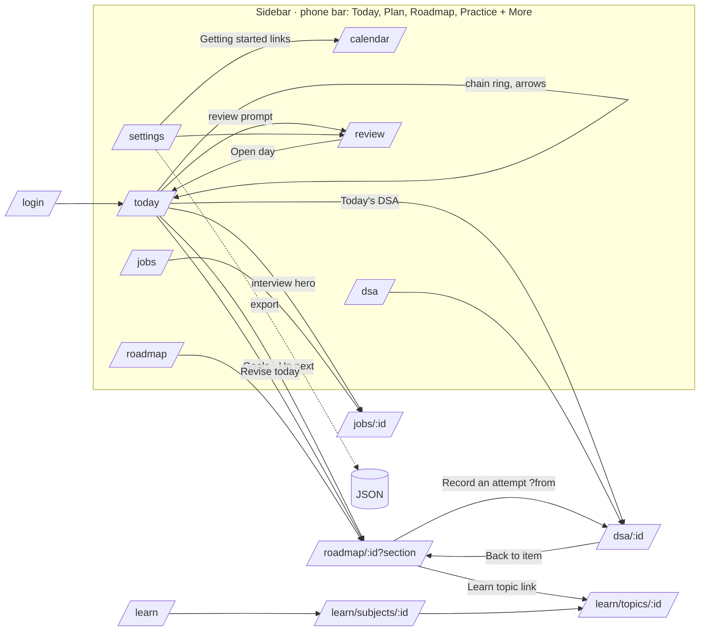

# Silsila design review — Phase 1: the experience map

Date 2026-10-21, branch `feat/wi-012-roadmap-tracker` at the review commit. Read-only. Context taken from `CLAUDE.md` and the owner's learner notes because the brief's CONTEXT block was not filled in; items marked "Hypothesis" are inferred.

## Context used

- **Product:** Silsila, a single-owner personal execution system: routines become dated plans, what happened is recorded, DSA and technical revision run on spaced dates, job applications and interview rounds are tracked, a weekly review closes the week, reminders arrive in an inbox and by Web Push. Live at usesilsila.me (Render + Supabase).
- **Users and roles:** one role, the owner (a full-stack engineer with about four years of experience preparing for SDE II loops). Daily on a laptop at a desk and on a phone during the day; the phone is the "mark it and move on" device (Hypothesis from the bottom-bar design and the learner notes).
- **Top 5 tasks:** (1) run the current time block on Today: start, stop, complete, skip; close the day. (2) Study a roadmap item: copy the prompt, study elsewhere, mark it done, keep a note. (3) Record a DSA attempt and work the revision queue. (4) Track a job application: add it, move stages, schedule an interview round, prepare, log the outcome. (5) Plan the week: routines, Prepare next week, the Monday review.
- **Known complaints (from this session):** the first WI-012 roadmap read as cluttered (every control on every row); Practice was a flat 219-row list; Learn's purpose was unclear next to the roadmap. (All addressed on this branch before the review.)
- **Brand feel:** calm, factual, restrained; no streaks, scores or hustle copy; plain functional labels; light by default.
- **Admired patterns (Hypothesis):** Linear's density and keyboard model; Things' quiet daily list; the plainness of GitHub's settings pages.
- **Running locally:** `pnpm google:fake` + `pnpm dev` against `silsila_dev_empty`; sign in as the fake owner. Test values only; the example seed was run for populated states (it adds only for a new owner, so Jobs and Learn stayed thin: one application, no rounds, no subjects).

## Screens and how they are reached

| Route                                                  | Screen                                                                                                                                                                                            | Reached from                                   | Notes                                                                                                                                                 |
| ------------------------------------------------------ | ------------------------------------------------------------------------------------------------------------------------------------------------------------------------------------------------- | ---------------------------------------------- | ----------------------------------------------------------------------------------------------------------------------------------------------------- |
| `/login`                                               | Sign in                                                                                                                                                                                           | any private URL when signed out                | one button, Google OIDC                                                                                                                               |
| `/`                                                    | Redirect                                                                                                                                                                                          | —                                              | sends to `/today`                                                                                                                                     |
| `/today` (`?date=`)                                    | Today                                                                                                                                                                                             | nav; chain rings; day arrows; `T`              | hero (now/next), stats, timeline, aside cards (Goals, Revise today, review prompt, jobs, technical prep, DSA), day-closed card, Start here when empty |
| `/calendar` (`?week=`)                                 | Plan                                                                                                                                                                                              | nav "Plan"                                     | week grid, routines, Google status line, Prepare next week                                                                                            |
| `/roadmap`                                             | Roadmap overview                                                                                                                                                                                  | nav; Today Goals card                          | goal card, roadmap rows                                                                                                                               |
| `/roadmap/[id]` (`?section=&q=&show=`)                 | Roadmap page                                                                                                                                                                                      | overview rows; Today links; Practice back link | section nav, one open item, filters, Add items, Edit roadmap                                                                                          |
| `/dsa` (`?q=&status=`)                                 | Practice                                                                                                                                                                                          | nav                                            | due list, pattern bands, topics                                                                                                                       |
| `/dsa/[id]` (`?from=`)                                 | Problem                                                                                                                                                                                           | Practice rows; roadmap panel                   | facts, attempt form, history, edit                                                                                                                    |
| `/jobs` (`?q=&stage=`…)                                | Jobs                                                                                                                                                                                              | nav                                            | applications list, filters, add form                                                                                                                  |
| `/jobs/[id]`                                           | Application                                                                                                                                                                                       | Jobs rows; Today interview hero                | summary line, next action, rounds, prep, timeline, contacts, notes                                                                                    |
| `/review` (`?week=&step=week\|reflect\|plan\|details`) | Weekly review                                                                                                                                                                                     | nav; Today prompt; reminder                    | stepper with three steps and a Details view                                                                                                           |
| `/settings` (`?google=`)                               | Settings                                                                                                                                                                                          | nav                                            | Getting started, notifications, revision reminder, Google Calendar, appearance, account, status, export                                               |
| `/learn`, `/learn/subjects/[id]`, `/learn/topics/[id]` | Learn (off the menu)                                                                                                                                                                              | roadmap item links; URL                        | subjects, topics, mastery, activities                                                                                                                 |
| `/api/export`                                          | Download                                                                                                                                                                                          | Settings                                       | JSON                                                                                                                                                  |
| in-page overlays                                       | `?` shortcuts dialog (Today, Plan, Roadmap, roadmap page); phone More sheet; Disclosure panels (every form); ActionForm preview/confirm (routine edits); typed confirmation (calendar disconnect) | —                                              | no modals                                                                                                                                             |
| `error.tsx`, `loading.tsx`                             | Error, Loading                                                                                                                                                                                    | automatic                                      | card with retry; "Loading your workspace…"                                                                                                            |

## Navigation and information architecture

## Top task paths today (clicks counted from the page the task starts on)

| Task                    | Path                                                                                                                                                                                                                                                                                                               | Clicks | Fields                     | Waits / decision points                                                    |
| ----------------------- | ------------------------------------------------------------------------------------------------------------------------------------------------------------------------------------------------------------------------------------------------------------------------------------------------------------------ | ------ | -------------------------- | -------------------------------------------------------------------------- |
| 1 Run the current block | Today → Start (1) → work → Complete (1) [or Skip (1, undo) / Cancel (1, undo)] → at night Close the day (1) → rating + notes + carry forward (3 fields) → Save (1)                                                                                                                                                 | 3–5    | 0–3                        | which block is "now" is decided for you; Skip asks a reason (optional)     |
| 2 Study a roadmap item  | Today "Up next" (1) → item opens → Copy prompt (1) → study elsewhere → Done (1 from the row, or D) → note (1 field, saves on blur)                                                                                                                                                                                 | 3      | 0–1                        | choose a scenario (defaulted to the last one)                              |
| 3 Record an attempt     | Practice → open a pattern band (1) → problem (1) → "How did it go?" (1 choice) → Save (1) → back (1)                                                                                                                                                                                                               | 5      | 1 required, 3 optional     | confidence inferred; minutes prefilled from a running session              |
| 4 Track an application  | Jobs → Add application (1) → form (company, role required; 10+ optional) → Save (1) → open it (1) → Change stage (1) → Add interview (1) → round form (title, type, start, end, timezone…) → Save (1) → prep items (1 each) → after the interview: Log outcome (1) → outcome + reflections (3–4 fields) → Save (1) | 9+     | 2 required + many optional | long forms; stage names (RECRUITER_SCREEN…) are a decision each time       |
| 5 Plan the week         | Plan → Add routine (1) → form (title, category, days, start, end, goal…) → Save (1) → Prepare next week on review step 3 (1) → Monday: Review → This week (read) → Next: Reflect (1) → 4 fields → Save (1) → Next week (1) → priorities (1 each) → Save (1)                                                        | 8+     | 6+                         | the review lives behind three steps; "Prepare next week" is on step 3 only |

## Design foundation

- **Tokens** (`src/app/design-tokens.css`): colour (ivory canvas, teal primary, success/warning/danger/info with soft and text variants), radii 8/12/14/18/pill, spacing 4–48, Inter and Cormorant, shadows, motion. Dark theme is a `.dark` class on `<html>` chosen in Settings (light is the default regardless of OS, a product rule).
- **Styles** (`src/app/globals.css`, about 2 700 lines): all component styling lives here, sectioned by work item. 489 px literals of which 76 are off the spacing scale, 57 literal font sizes, 22 literal radii, 3 literal colours. `--space-*` is used twice; `--radius-*` 14 times. Sizes are consistent in practice (13 px meta, 15 px body, 19 px h2, 36 px h1) but not tokenised.
- **Components** (`src/components/`): `Button` (pending state), `ActionForm` (feedback, undo, preview/confirm), `Disclosure`/`DisclosureTabs` (in-place panels, no modals), `ResourceLink`, `CategoryIcon`, `DateJump`, `PageShortcuts`, `BrandMark`, `ProgressBar` (new on this branch). Icons: lucide-react at 12–20 px, plus unicode glyphs (← → ↗ ✓ ○ ◐ △ ↑ ↓ ↳ ·) in several places.
- **Bypasses:** raw `<button className="button">` in 61 places against 16 uses of the shared `Button`; `.button.destructive` defined and unused; five empty-state styles; `.dsa-item` reused as the generic row in 12 places and defined twice; the review chart uses inline sizes (acceptable).

## Screenshots

`docs/design-review/screenshots/<screen>-<width>[-dark|-state].jpg`, taken with the desktop app's built-in browser at 390, 768 and 1440 px (light; dark at 1440), signed in as the fake owner. Playwright was not used: it is not a dependency of this repository and sign-in needs the fake Google round trip. Captured states: populated pages, the Start here empty states where the seed left them, loading, the shortcuts overlay, an open form panel, the phone More sheet, a roadmap section with an open item, Practice with a band open, the review steps.
